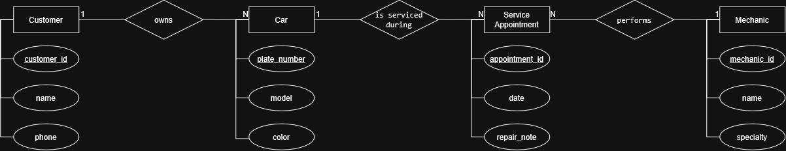

# INFOMAN1 – Week 2 Lab: Conceptual ERD Case Study
**Name:** Jan Liam E. Arias
**Student ID:** 2510499
**Section:** N/A

## Task 1 — Candidate Entities

| Entity | Justification |
|---|---|
| Customer | The scenario states "the shop has many customers, and each customer may bring in one or more cars," so Customer is a distinct entity that needs to be tracked in the database by rows of data. |
| Car | The scenario describes that the car has its own characteristics (“each car has a model, a plate number, and a color”) and, therefore, it is possible to create the entity “Car” with its attributes instead of making them a part of the Customer entity. |
| Mechanic | The scenario states that the shop "employs several mechanics, each of whom has a name and a specialty," hence the Mechanic entity should be tracked, having attributes Name and Specialty. |
| Service Appointment | The scenario states that the work is done "as part of a scheduled service appointment," which "has a date and a short note about the repair," having its own attributes and connecting Cars and Mechanics, hence the service appointment is an entity (the relationship between Cars and Mechanics is many-to-many, requiring an independent entity with its own attributes). |

## Task 2 — Attributes per Entity

### Customer
- Primary Key: customer_id
- Attributes:
  - customer_id — Domain: numeric, auto-generated unique ID
  - name — Domain: text
  - phone — Domain: text

### Car
- Primary Key: plate_number
- Attributes:
  - plate_number — Domain: text, unique per vehicle
  - model — Domain: text
  - color — Domain: text

### Mechanic
- Primary Key: mechanic_id
- Attributes:
  - mechanic_id — Domain: numeric, auto-generated unique ID
  - name — Domain: text
  - specialty — Domain: text, e.g. engine / brakes / electrical

### Service Appointment
- Primary Key: appointment_id
- Attributes:
  - appointment_id — Domain: numeric, auto-generated unique ID
  - date — Domain: date
  - repair_note — Domain: text

## Task 3 — Relationships

| Relationship (verb phrase) | Between | Cardinality | Checked both directions? |
|---|---|---|---|
| owns | Customer ↔ Car | 1:N | Yes — It is important to note that one customer can bring in more than one car, and from the car’s perspective, each car “belongs to exactly one customer.” |
| works on | Mechanic ↔ Car | M:N | Yes — “one mechanic may work on many different cars,” and “one car may be serviced by different mechanics on different visits.” There are many on both sides, so it is M:N; in the ERD, it is shown by the connecting entity Service Appointment. |
| is serviced during | Car ↔ Service Appointment | 1:N | Yes — one car can have many appointments in its lifetime, but each individual appointment is for only one car. |
| performs | Mechanic ↔ Service Appointment | 1:N | Yes — one mechanic can have many appointments, but each appointment is for only one mechanic. |

## Task 4 — Conceptual ERD

