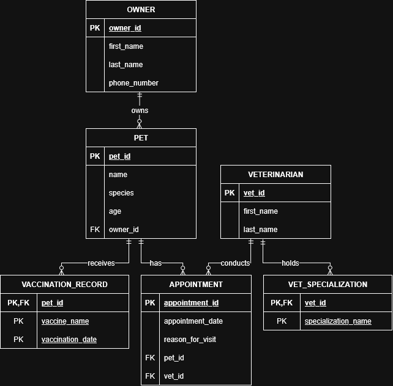

# INFOMAN1 Week 3 Lab: Logical ERD Modeling

## Task 1 — Classify Attributes and Identify Weak Entities

1. **Composite Attributes:**
    * `full_name` (Owner & Veterinarian): The scenario states that this attribute "consists of first name and last name". This should be decomposed into `first_name` and `last_name` attributes in the logical design.

2. **Multivalued Attributes:**
    * `specialization` (Veterinarian): The scenario states it in singular, but a veterinarian can realistically hold several specializations (e.g., Surgery, Dentistry), and this lab requires resolving a multivalued attribute. We therefore model it as multivalued and resolve it into a separate `vet_specialization` table to satisfy 1NF. (Stated design assumption: if a single specialization were intended, it would remain a simple attribute of `veterinarian`.)

3. **Derived Attributes:**
    * `age` (Pet): Age can be derived from the `date_of_birth`. (Note: Per the scenario we retain `age` in the schema. In real-world design one would store `date_of_birth` and derive age dynamically.)

4. **Weak Entity Identification:**
    * Vaccination Record is a Weak Entity. The scenario specifically states that it "cannot be uniquely identified or looked up on its own" and "only makes sense in relation to the specific pet it belongs to." It is dependent on the `Pet` entity for its existence.

## Task 2 — Specify Participation Constraints

1. **Owner – Pet**
    * Rule: an owner may have zero or many pets ("not required to have any pets on file"); each pet belongs to exactly one owner, mandatorily ("every pet must belong to exactly one owner").
    * Drawn at the PET end: circle (optional) + crow's foot (many) = (0,N).
    * Drawn at the OWNER end: tick (mandatory) + single line (one) = (1,1).

2. **Pet – Appointment**
    * Rule: a pet may have zero or many appointments over time; each appointment must specify exactly one pet ("must specify exactly one... pet—an appointment cannot exist without both").
    * Drawn at the APPOINTMENT end: circle (optional) + crow's foot (many) = (0,N).
    * Drawn at the PET end: tick (mandatory) + single line (one) = (1,1).

3. **Veterinarian – Appointment**
    * Rule: a veterinarian may conduct zero or many appointments ("can conduct multiple appointments over time or none at all"); each appointment must specify exactly one veterinarian ("must specify exactly one veterinarian").
    * Drawn at the APPOINTMENT end: circle (optional) + crow's foot (many) = (0,N).
    * Drawn at the VETERINARIAN end: tick (mandatory) + single line (one) = (1,1).

4. **Pet – Vaccination Record**
    * Rule: a pet may have zero, one, or several vaccination records ("may have zero, one, or several vaccination records"); each record belongs to exactly one pet, mandatorily ("only makes sense in relation to the specific pet it belongs to").
    * Drawn at the VACCINATION_RECORD end: circle (optional) + crow's foot (many) = (0,N).
    * Drawn at the PET end: tick (mandatory) + single line (one) = (1,1).
    * Because Vaccination Record is a weak entity, this is drawn as an identifying relationship (double line to the double-bordered entity).

## Task 3 — Build the Logical ERD

## Task 4 — Translate to Relational Schema Notation

**owner**(``owner_id``, first_name, last_name, phone_number)

**pet**(``pet_id``, name, species, age, owner_id*)
*Note: owner_id references owner(owner_id)*

**veterinarian**(``vet_id``, first_name, last_name)

**vet_specialization**(``vet_id*``, ``specialization_name``)
*Note: vet_id references veterinarian(vet_id). This table resolves the multivalued attribute.*

**appointment**(``appointment_id``, appointment_date, reason_for_visit, pet_id*, vet_id*)
*Note: pet_id references pet(pet_id); vet_id references veterinarian(vet_id)*

**vaccination_record**(``pet_id*``, ``vaccine_name``, ``vaccination_date``)
*Note: pet_id references pet(pet_id). Weak entity: PK = parent key + partial key (vaccine_name, vaccination_date).*

## Task 5 — Key Justification & Schema Validation

**Key Justification:**

1. **Surrogate key (`owner_id`):** The rationale for utilizing the Surrogate key was to guarantee that the database record will remain uniquely identifiable irrespective of updates to the attributes in the future. In this case, a phone number is not a good choice since it may change or be shared by different owners.
2. **Composite Natural Key (`vaccination_record`):** The rationale for the composite natural key is that a vaccination record is a weak entity dependent on the pet it was administered to, so the parent's PK (`pet_id`) must be part of the primary key (while also acting as a foreign key). The partial key is the pair (`vaccine_name`, `vaccination_date`) rather than `vaccine_name` alone, because a pet may receive the same vaccine again on a later date (e.g., an annual booster), so vaccine name by itself cannot uniquely distinguish a pet's records.

**Schema Validation:**

* **Owner & Pet:** Scenario: "A pet owner... is not required to have any pets on file at a given time, but every pet must belong to exactly one owner." → Schema: the composite name is stored in `owner` as `first_name`/`last_name`, and `pet.owner_id*` is a mandatory FK to `owner(owner_id)`, enforcing the "exactly one owner" rule.
* **Appointments:** Scenario: "Every appointment record... must specify exactly one veterinarian and exactly one pet—an appointment cannot exist without both." → Schema: `appointment.pet_id*` and `appointment.vet_id*` are mandatory FKs to `pet(pet_id)` and `veterinarian(vet_id)`.
* **Veterinarian workload:** Scenario: "A veterinarian... can conduct multiple appointments over time or none at all." → Schema: a one-to-many relationship from `veterinarian` to `appointment`; no counter-FK is needed on the veterinarian side.
* **Multivalued Attribute:** Scenario: "A veterinarian, identified by a vet ID, full name, and specialization..." → Schema: `specialization` is resolved into the dependent table `vet_specialization(vet_id*, specialization_name)` to avoid repeating groups (design assumption stated in Task 1).
* **Weak Entity:** Scenario: "Each vaccination record only makes sense in relation to the specific pet it belongs to, meaning it cannot be uniquely identified or looked up on its own." → Schema: `vaccination_record`'s PK embeds `pet_id*` referencing `pet(pet_id)`, with partial key (`vaccine_name`, `vaccination_date`).

## Self-Check

* [x] All tasks committed with individual, meaningful commit messages
* [x] All files placed inside `week3/`
* [x] This file completed `answers.md`
* [x] Repository link pasted into Moodle (no files uploaded)
